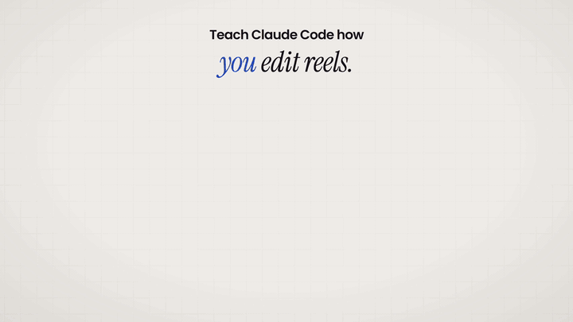
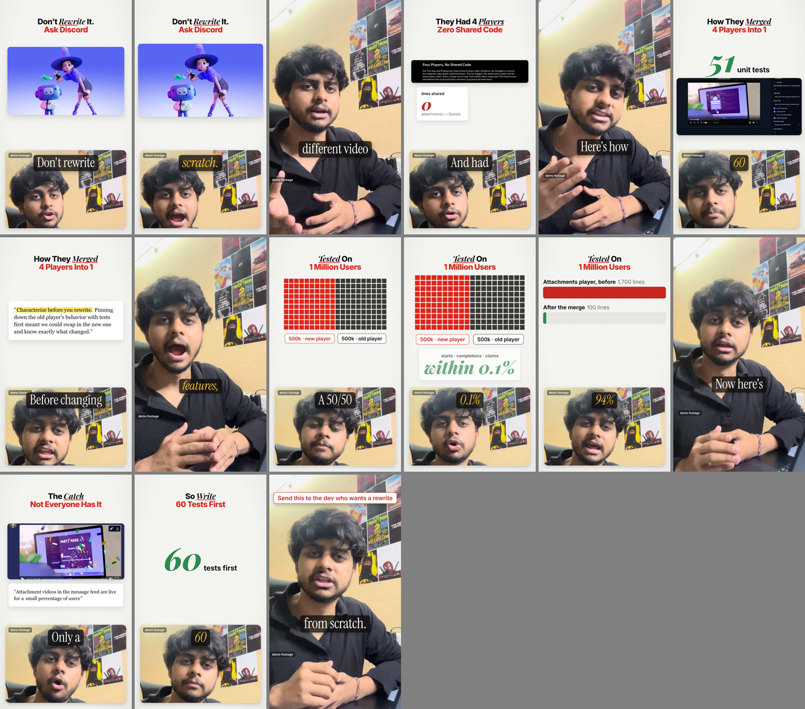
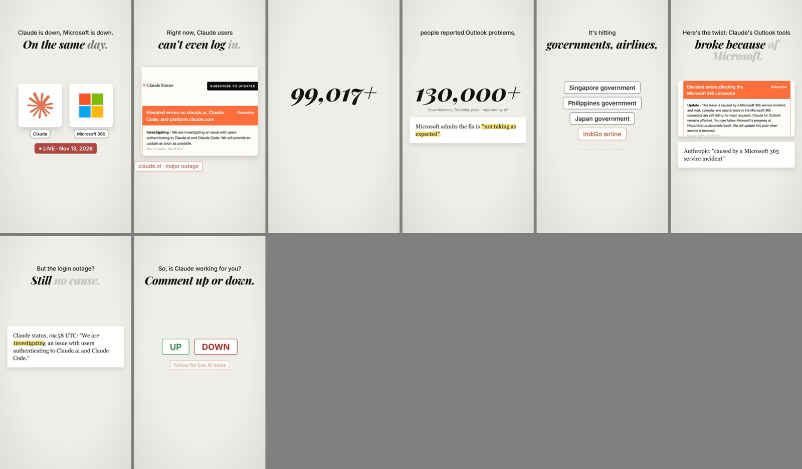
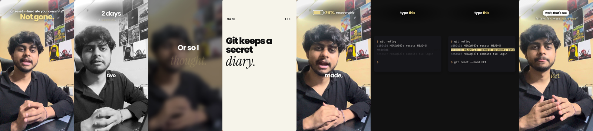
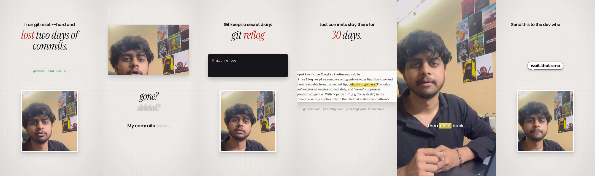
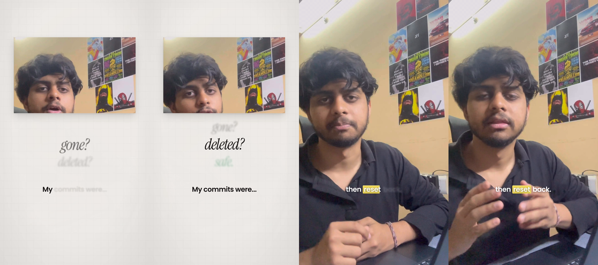

<!-- Created by Tejas — https://github.com/Tejas-pr/claude-editing-style (Apache-2.0; keep this notice, see NOTICE) -->
# claude-editing-style

<p align="center">
  <a href="docs/demo.mp4"></a>
</p>
<p align="center"><b>▶ <a href="docs/demo.mp4">Watch the 37-second demo with sound</a></b> · made with this plugin itself
(<b>Folio</b> style, 16:9, real screenshots, sound effects from the Edits app)</p>

**Video editing made simple: give Claude Code your video and a style name, get the finished reel back.**

```
/editing-style:edit my-video.mov folio silk
```

A Claude Code plugin by **[Tejas](https://github.com/Tejas-pr)** that gives Claude a library of numbered **video
styles**, **caption styles** and **script styles** for Reels / Shorts / TikTok, lets you **train it on reels you like**
(`/build`), and edits your recording in the style you pick: assembled in the **Edits app** (via its MCP server) or
**rendered locally** with headless Chrome + ffmpeg.

> **Origin:** created by Tejas — https://github.com/Tejas-pr/claude-editing-style · Apache-2.0.
> Copies and forks must keep the [NOTICE](NOTICE) file and this attribution.

---

## What it does

1. **You build a library** (`/editing-style:build`): Claude asks you 4 questions, each with a free-text input box:
   * **Reel idea** — a reel to learn from (paste a link) or the idea you want to make
   * **Caption idea** — the caption look you want (a link or a description)
   * **Script idea** — how your scripts should be written (a structure, a hook formula, a creator)
   * **Video style idea** — the editing style to learn (layout, motion, where your face sits)

   It studies each link frame by frame in the browser (it never downloads anyone's video), turns it into concrete
   rules, renders a test, and **saves it as a numbered card** (`style-06`, `cap-06`, `script-04`, `idea-01` …) in
   `./reel-library/`. Nothing is overwritten; your library grows.
2. **You edit** (`/editing-style:edit my-recording.mov`): Claude opens a dialog — *which video style? which caption
   style? which script style? Edits app or local render?* — then cuts your pauses, speeds you up, builds the motion
   pages, takes real screenshots of the tweets / posts / articles you cite, and delivers the reel with an honest
   **SHIP / FIX FIRST / RE-RECORD** verdict.

## Built-in styles

| id | style | look | preview |
|---|---|---|---|
| **style-01** | **Duet** · split card | grid-paper panel on top, you in a rounded card at the bottom, 1–2-word captions on the seam |  |
| **style-02** | **Ink** · paper classic | warm grid paper, small line + big bold-italic line, cards / quotes / counts |  |
| **style-03** | **Glow** · full-face story | you full screen; blur pages, colour step cards, score meter, legal-pad recap |  |
| **style-04** | **Folio** · paper pro *(default)* | paper headline + **real screenshots** with highlighter, **smooth motion**, your face in a card that moves (bottom / top / center / full / hidden) |  |
| **style-05** | **Echo** · paper subtitles | style-04 with one subtitle line under the media, keyword in a yellow box |  |

Each style has its own command: **`/editing-style:duet`**, **`/editing-style:ink`**, **`/editing-style:glow`**,
**`/editing-style:folio`**, **`/editing-style:echo`** (followed by your video path) — or pick in the `/editing-style:edit` dialog.

Caption styles: **Velvet** (`cap-01`, serif on a dark band) · **Volt** (`cap-02`, bold outlined caps) · **Silk**
(`cap-03`, Poppins + serif-italic keyword) · **Heritage** (`cap-04`, classic bold italic) · **Marker** (`cap-05`,
subtitle line with a yellow keyword box) — [preview](skills/reel-edit/styles/captions.png).
Script styles: **Turn** (moment → cost → turn → action) · **Twice** (say every idea twice) · **Flash** (news in 30 s).
Full catalogue: [STYLES.md](skills/reel-edit/STYLES.md).

**Smooth motion (every style):** entries ease in out of a blur, headline words rise into focus, pages hand over with a
blur dissolve, a slow drift, eased camera pushes onto the highlighted line, a word roller. **Real sources:**
`source_shot.mjs` screenshots a tweet or Instagram post from its official embed, or the exact paragraph of an article
that contains a phrase — and tells you where the phrase is so the highlighter lands on it.

---

## Install

**Requirements:** [Claude Code](https://docs.claude.com/en/docs/claude-code), macOS (recommended, with the Edits app) or Linux, **Node 22+**, **Python 3**,
**ffmpeg**, **Google Chrome** (headless rendering). Optional: [whisper.cpp](https://github.com/ggml-org/whisper.cpp)
(`whisper-cli` + a ggml model) for local word timing; the **Edits** app with its MCP server for in-app assembly.

```bash
brew install node python ffmpeg whisper-cpp
```

In Claude Code:

```
/plugin marketplace add Tejas-pr/claude-editing-style
/plugin install editing-style@claude-editing-style
```

Restart Claude Code (or run `/reload-plugins` if your version has it), then in your video project folder:

```
/editing-style:setup
```

This copies the starter library into `./reel-library/`, adds your videos to `.gitignore`, checks the tools, and asks
for your brand basics (handle, accent colour, default ask, SFX/music folders).

### Which way to render?

| your computer | best path |
|---|---|
| **macOS** | **Use the Edits app** — it makes the whole process simple: Claude cuts, places the motion, adds music and sound effects from the Edits library, and exports in the app. Connect it once (below). |
| macOS without Edits, **Linux** | **Local render** — headless Chrome + ffmpeg (+ whisper.cpp for word timing). Same styles, same quality; add your own music file. |
| **Windows** | Not supported yet (the scripts use zsh and macOS/Linux paths). Support for more systems will be added as they're tested — watch the repo or open an issue. |

### Connect the Edits app (macOS)

If you use the Edits app and it exposes an MCP server, add it once (use the URL and token your app shows):

```bash
claude mcp add --transport http --scope user metapilot-native http://127.0.0.1:19501/mcp --header "Authorization: Bearer <YOUR_TOKEN>"
```

Then open Edits and run `/mcp` in Claude Code to confirm `metapilot-native` is connected. **Never commit your token.**
Without Edits, everything renders locally.

---

## Use it

### In one line

```
/editing-style:edit <video> <video-style> <caption-style> [script-style] [edits|local] [16:9] [notes]
```

```
/editing-style:edit take3.mov folio silk                         # Folio pages + Silk captions
/editing-style:edit take3.mov duet volt turn edits                # in the Edits app, Turn script
/editing-style:edit none folio silk 16:9 "explain my repo"        # no recording: a text + screenshot video
/editing-style:folio take3.mov                                    # shortcut: style already chosen
```

Leave anything out and Claude asks for just that part in a dialog. When it's done you get the finished video's path
and an honest **SHIP / FIX FIRST / RE-RECORD** verdict.

### All commands

| command | what happens |
|---|---|
| `/editing-style:setup` | create `./reel-library/` + `./reels/`, check tools, save your brand |
| `/editing-style:build [link or note]` | the 4-question dialog → study → test render → save numbered cards |
| `/editing-style:library` | list every saved style, caption, script and idea with previews |
| `/editing-style:edit <video> [style] [captions] [script] [edits\|local] [notes]` | one-line edit; only missing choices are asked |
| `/editing-style:update` | pull new built-in styles into your library (after updating the plugin) |
| `/editing-style:duet` · `:ink` · `:glow` · `:folio` · `:echo` `<video>` | the same edit with that style already chosen |
| `/editing-style:reel-edit` | the skill itself (also loads automatically when you ask Claude to edit a reel) |

(If no other plugin uses the same names, Claude Code also accepts the short forms like `/build` and `/edit`.)

### A full edit, step by step

1. Record yourself (face cam) or a voiceover. Put the file anywhere.
2. `/editing-style:edit ~/Videos/raw/take3.mov "git reflog saves deleted commits"`
3. Pick in the dialog: e.g. **Folio** (style-04), **Silk** captions, **Turn** script, **Local render** — or run `/editing-style:folio take3.mov` directly.
4. Tell Claude where your face should sit on each beat and which sources to show (links to tweets, posts, docs).
5. Claude:
   * cuts pauses ≥ 0.3 s and speeds up 1.15× (`local_cut.py`, or in Edits), gets word times (whisper.cpp / Edits),
   * reviews your voice (pace, clarity, hook energy) and tells you if a line should be re-recorded,
   * screenshots each source (`source_shot.mjs`), writes `build.py`, renders a check sheet, fixes what's off,
   * delivers `reels/<date>-<slug>/final.mp4` at 1440×2560, −14 LUFS (or assembles in Edits and exports 2K),
   * gives the verdict and offers to save anything new into your library.

### Local render only (no Edits)

```bash
S=~/.claude/plugins/…/skills/reel-edit           # the plugin's skill folder (Claude knows it)
python3 -I $S/scripts/local_cut.py raw.mov reels/my-reel --speed 1.15 --model ~/models/ggml-small.en.bin
# … Claude writes reels/my-reel/build.py → motion.html …
zsh $S/scripts/local_render.sh reels/my-reel/motion.html reels/my-reel/face-cut.mp4 reels/my-reel/final.mp4 [music.mp3]
```

---

## Updates: new styles keep coming

New video, caption and script styles are trained and added to this repo over time (see [CHANGELOG.md](CHANGELOG.md)).
Get them with:

```bash
claude plugin marketplace update claude-editing-style
claude plugin update editing-style@claude-editing-style
```

Restart Claude Code, then run `/editing-style:update` in your project: new built-in styles are copied into your
library and **your own cards are never touched**. Want to add a style to the plugin? See [docs/ADDING-STYLES.md](docs/ADDING-STYLES.md).

## Your library (persisted, private)

```
reel-library/
  INDEX.md                 one line per card; the edit dialog reads this
  brand.md                 handle, accent colour, default ask, SFX/music folders
  video-styles/  style-01 … style-05 (built-in), style-06+ (yours, from /build) + preview PNGs
  caption-styles/ cap-01 … cap-05, cap-06+ (+ .css when it's a new look)
  script-styles/  script-01 … script-03, script-04+
  reel-ideas/     idea-01+ (link, what to copy, what not to copy, why it works)
reels/<date>-<slug>/        one folder per reel: build.py, motion.html, screenshots, CREDITS.md, renders
```

The library and your reels live in **your** project, not in this repo. The repo's [.gitignore](.gitignore) also keeps
videos, audio, renders, scripts and libraries out if you work inside a clone.

## How it works (for contributors)

* `skills/reel-edit/templates/` — `engine.js` (frame-exact seek engine: `window.__seek(t)`), `components.css`, page
  templates `split.html`, `paper.html`, `story.html`, caption presets in `captions/`.
* `skills/reel-edit/scripts/` — `render.mjs` (drives headless Chrome over CDP, pipes frames to ffmpeg; `--alpha` HEVC
  overlay, `--stills` check sheets, `--face` local face), `reel_lib.py` (build helpers, `STYLES`, `assemble()`),
  `source_shot.mjs`, `local_cut.py`, `local_render.sh`, `cut_plan.py` (Edits cuts), `finish-export.sh` (loudness).
* Worked example: [docs/EXAMPLE-style-04.md](docs/EXAMPLE-style-04.md). 

## License and attribution

[Apache License 2.0](LICENSE). You may use, copy, modify and share this — **but every copy, fork or derivative must keep
the [NOTICE](NOTICE) file and the credit "Created by Tejas — https://github.com/Tejas-pr/claude-editing-style"**
(Apache-2.0, section 4). The original repository is maintained only by its owner; contributions are welcome as pull
requests. Fonts are loaded from Google Fonts (SIL Open Font License). Screenshots you take of other people's posts
remain theirs: credit them in each reel's `CREDITS.md`.

Made with ❤️ by **Tejas** · [github.com/Tejas-pr](https://github.com/Tejas-pr)
